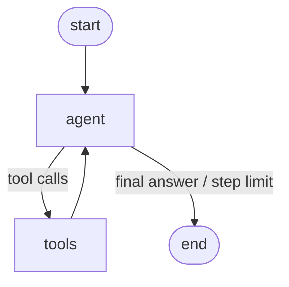

# LangGraph Research Agent

A tool-using research assistant built with [LangGraph](https://langchain-ai.github.io/langgraph/). It reasons over a question, calls tools (calculator, Wikipedia, live web search, clock), and loops until it can give a sourced answer. Conversations are persisted, so you can resume a thread later, and an optional approval mode lets you confirm every tool call before it runs.

## Architecture



| Piece | File | What it does |
|---|---|---|
| State | `state.py` | `messages` (with the `add_messages` reducer) and a per-turn `steps` counter |
| Agent node | `graph.py` | Calls the LLM with tools bound and a system prompt; enforces `MAX_STEPS` |
| Tools node | `graph.py` | Prebuilt `ToolNode` with `handle_tool_errors=True`, so failures go back to the LLM instead of crashing |
| Router | `graph.py` | Conditional edge: tool calls go to `tools`, otherwise `END` |
| Memory | `cli.py` | `SqliteSaver` checkpointer keyed by `thread_id` |
| Human in the loop | `graph.py`, `cli.py` | `interrupt_before=["tools"]` pauses the graph; the CLI resumes or injects a rejection |
| Tools | `tools.py` | `calculator` (AST based, no `eval`), `current_datetime`, `wikipedia_summary`, `web_search` (Tavily) |
| LLM | `llm.py` | Swap between Anthropic and OpenAI with one env var |

The graph is built explicitly with `StateGraph` rather than `create_react_agent`, so every node and edge is visible and easy to extend.

## Setup

```bash
python -m venv .venv
source .venv/bin/activate          # Windows: .venv\Scripts\activate
pip install -e ".[dev]"
cp .env.example .env               # then add your API key(s)
```

Required: `ANTHROPIC_API_KEY` (default provider) or `OPENAI_API_KEY` with `LLM_PROVIDER=openai`.
Optional: `TAVILY_API_KEY` enables the `web_search` tool. Without it the agent still has the other three tools.

## Usage

```bash
research-agent                     # start a new conversation
research-agent --thread notes      # create or resume the "notes" thread
research-agent --approve           # approve each tool call manually
research-agent --graph             # print the compiled graph as Mermaid
```

Example session:

```
You: What is the population of Adelaide divided by 3?
  -> wikipedia_summary({'topic': 'Adelaide'})
  <- wikipedia_summary: Adelaide ... population of about 1.4 million ...
  -> calculator({'expression': '1400000 / 3'})
  <- calculator: 466666.6666666667

Agent: Adelaide has roughly 1.4 million residents, so a third is about 466,667.
Source: https://en.wikipedia.org/wiki/Adelaide
```

### Using the graph from Python

```python
from langchain_core.messages import HumanMessage
from langgraph.checkpoint.memory import InMemorySaver
from research_agent.graph import build_graph
from research_agent.llm import get_chat_model
from research_agent.tools import get_tools

graph = build_graph(
    get_chat_model("anthropic", "claude-sonnet-5-5"),
    get_tools(),
    checkpointer=InMemorySaver(),
)
config = {"configurable": {"thread_id": "demo"}}
result = graph.invoke({"messages": [HumanMessage("What is 2**10?")], "steps": 0}, config)
print(result["messages"][-1].content)
```

## Tests

```bash
pytest
```

The suite uses a scripted fake chat model, so it runs offline with no API keys. It covers direct answers, the tool loop, the step limit, tool error recovery, multi-turn memory, and the approval interrupt.

## Extending it

- **Add a tool:** write a function with `@tool` in `tools.py` and add it to `get_tools()`. The docstring is what the LLM reads, so make it specific.
- **Add a node:** for example a `reflect` node that critiques the draft answer before `END`, or a `planner` node before `agent`.
- **RAG:** add a retriever tool over your own documents (a vector store such as Chroma or FAISS).
- **Serve it:** wrap `graph.stream(...)` in a FastAPI endpoint, or deploy with LangGraph Platform using a `langgraph.json`.
- **Observe it:** set `LANGSMITH_TRACING=true` and `LANGSMITH_API_KEY` to trace every run in LangSmith.

## Project layout

```
langgraph-research-agent/
├── pyproject.toml
├── .env.example
├── src/research_agent/
│   ├── config.py      # env-based settings
│   ├── state.py       # AgentState
│   ├── tools.py       # tool definitions
│   ├── llm.py         # model factory
│   ├── graph.py       # StateGraph wiring
│   └── cli.py         # interactive CLI
└── tests/
    ├── conftest.py    # scripted fake LLM
    ├── test_tools.py
    └── test_graph.py
```
